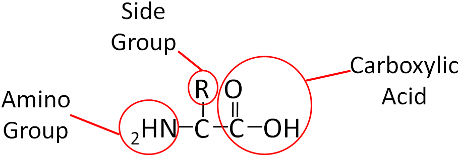
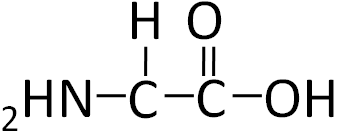
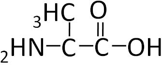
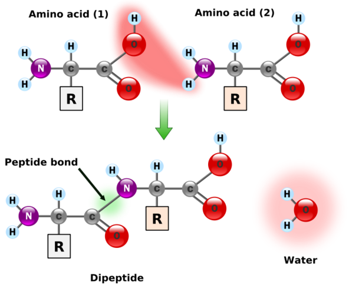
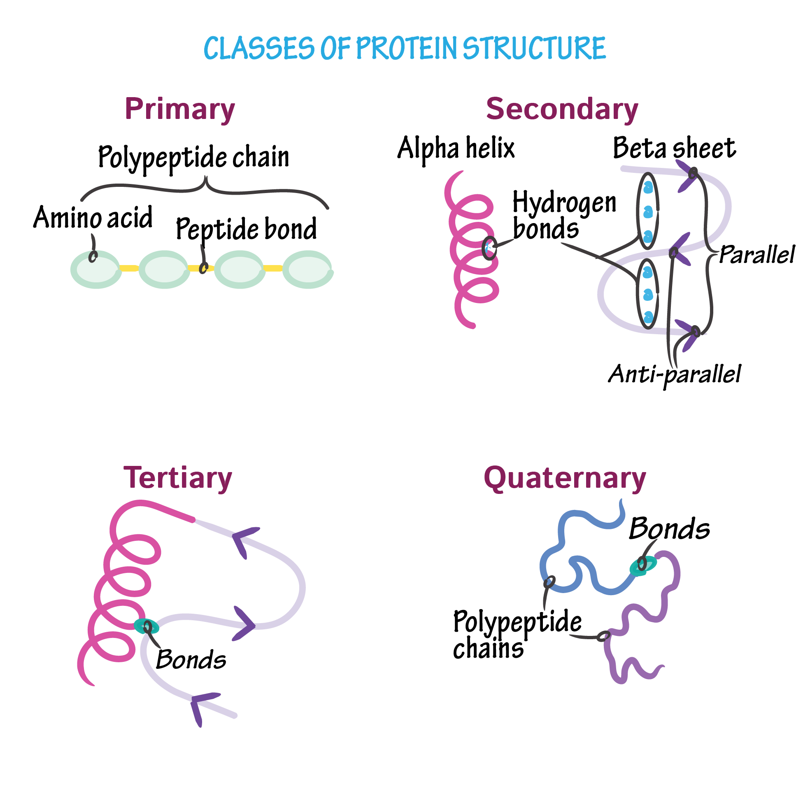

import ProteinGraph from '@/components/jepa/ProteinGraph.tsx';
import PredictionGame from '@/components/jepa/PredictionGame.tsx';
import ResultBars from '@/components/jepa/ResultBars.tsx';
import RankReversal from '@/components/jepa/RankReversal.tsx';
import LossCollapse from '@/components/jepa/LossCollapse.tsx';
import MoreData from '@/components/jepa/MoreData.tsx';
import DatasetNumbers from '@/components/jepa/DatasetNumbers.tsx';
import CountingNumber from '@/components/CountingNumber.tsx';
import HoverCard from '@/components/HoverCard.tsx';
import Highlight from '@/components/Highlight.tsx';
import { MutationSwap, MutationNotation, Stability } from '@/components/jepa/ProteinBasics.tsx';
import StructureStory from '@/components/jepa/StructureStory.tsx';
import PolypeptideChain from '@/components/jepa/PolypeptideChain.tsx';

## Where this started

This summer I went to PSI:ML, a summer school on scientific machine learning at the Petnica Science Center in Serbia. I wrote about it in my previous post. If you're a student, read it and think about applying next year, because you could be there too, and it's worth it.

The best thing I took from it was breadth. I saw so many sides of how AI is used in science that my urge to explore random corners of it grew. One of those corners was graph neural networks, and what they do in biology, drug discovery and genetics. Before the school I knew very little about graphs, and I can't say how much I loved the idea.

I had excellent lectures on this topic, and afterwards I learned a lot more through [the course materials](https://github.com/zenwor/sciml26_gjepa).

Before the experiment, we need two ideas: what a graph is, and what a protein is. I'm not a biologist either, and you don't need to be one to follow this. 🙂

## What is a protein?

Proteins are the molecular machines of life. They speed up reactions, carry molecules, pass signals and build the structure of cells. At the most basic level, a protein is just a chain of amino acids. <Highlight text="The order of that chain decides how it folds, and the shape decides what it does." client:visible />

That is also what makes proteins so interesting for machine learning: they are biological objects and structured data at the same time. A protein can be seen as a sequence, as a set of 3D coordinates, or, as we'll see later, as a graph.

### The building blocks

Amino acids are the building blocks. Every one of them has the same backbone, built around a central carbon (the alpha carbon), plus a side chain, also called the R-group.

  

6-Aminopenicillanic acid. Image: Kiantsu, [CC BY-SA 4.0](https://creativecommons.org/licenses/by-sa/4.0/), via [Wikimedia Commons](https://commons.wikimedia.org/wiki/File:6-Aminopenicillanic_acid_%286-APA%29.gif). Background made transparent.

The side chain is what makes the 20 amino acids different. Some avoid water, some like it, and some carry an electric charge. That matters, because each one pulls the chain a little differently, and together they decide how it folds.

Amino acids link up one after another, like beads on a string (the links are called peptide bonds). When that chain folds into a shape, it is a protein. Once an amino acid sits in a chain, we call it a <HoverCard label="residue" title="Residue" body="What an amino acid is called once it is part of a chain. In our graphs, one residue is one node." client:visible />. I'll use that word a lot, because <Highlight text="later each residue becomes a node in a graph" client:visible />. The order of the residues is the <Highlight text="sequence" type="underline" client:visible />, a string of letters, one per amino acid, like ACDEFG.

<PolypeptideChain client:visible />

Figures: Brian Lindshield, Kansas State University Human Nutrition Flexbook, CC BY, via [SUNY Nutrition on Lumen Learning](https://courses.lumenlearning.com/suny-nutrition/chapter/2-21-amino-acids/).

### From a chain to a shape

The sequence is only the first level. Proteins are not random strings of letters, they are shaped objects, and their structure builds up in four levels:

- Primary: the sequence of amino acids.
- Secondary: local patterns such as helices and sheets.
- Tertiary: the full 3D shape of one chain.
- Quaternary: how several chains fit together.

<StructureStory client:visible />

More pictures: [StudyMind, an illustrated introduction](https://studymind.co.uk/notes/proteins-and-amino-acids-an-introduction/).

### One letter can change everything

A mutation is a change in the sequence, and the simplest kind is a <Highlight text="point mutation" type="underline" client:visible />: one amino acid swapped for another. Sometimes nothing happens. Sometimes everything does. In sickle cell disease, a single swap at position 6 of hemoglobin's 146-amino-acid chain is enough to change the shape of red blood cells.

<MutationSwap client:visible />

Depending on where it happens and what the new amino acid brings, a mutation can change how tightly the protein packs, how it binds other molecules, or how stable the fold is. <Highlight text="This project is about the last one." client:visible />

### Staying folded

A folded protein isn't frozen. It keeps moving between a folded and an unfolded state, and stability is how strongly the folded state is preferred. Many weak interactions hold the fold together: water-avoiding packing, hydrogen bonds and charges. Conditions matter too, like temperature, pH and salt.

The energy gap between the two states is called ΔG. In this project, <Highlight text="a larger ΔG means a more stable protein" client:visible />.

### Putting a number on it

So how do we measure what a mutation does? We compare the mutant with the original protein, called the <Highlight text="wild type" type="underline" client:visible />, and look at how much the stability changed:

$$
\Delta\Delta G = \Delta G_{\text{mutant}} - \Delta G_{\text{wild type}}
$$

In the data I use, ΔΔG > 0 means the mutation stabilises the protein, ΔΔG < 0 means it destabilises it, and a value near zero means it has little effect. Papers differ on this sign, so always check it before comparing datasets.

<Stability client:visible />

The measurements come from the MegaScale experiment. Many protein variants are exposed to a protease, an enzyme that cuts unfolded proteins more easily than folded ones, so the more a variant survives, the more stable it is. Comparing each mutant with its wild type then gives ΔΔG, and that number is what our model will learn to predict.

One last bit of notation. A mutation such as E15Q is written as three pieces: the original amino acid (E, glutamate), the position (15) and the new amino acid (Q, glutamine).

<MutationNotation />

To score a mutation like this, it is not enough to know the letters. The model also needs to know where position 15 sits in the folded protein and what surrounds it. So the task is: take a protein structure and one mutation, and <Highlight text="predict ΔΔG" client:visible />.

During a summer research project at Petnica, my teammate Pau and I trained a graph neural network to learn representations of proteins.

One of our experiments did something strange.

The training loss started going <Highlight text="up" client:visible />.

This is usually the point where you start looking for a bug. We did have bugs to find, but this particular behaviour turned out to be more interesting. The model's representations were changing in a way we didn't fully understand, and the numbers we were using to judge them weren't telling us much about whether those representations were actually useful.

We finished the project with two questions I couldn't quite put away.

Why was the loss increasing? And how could we tell whether the model had learned something meaningful about proteins?

A few months later, I came back to those questions.

This time, I wanted to change just one thing: <Highlight text="what the model was asked to predict" client:visible />.

The answer was considerably less flattering to my original intuition than I'd expected.

## First, what are we trying to learn?

Proteins are long chains of amino acids that fold into three-dimensional structures.

I like to think of them as complicated little arrangements where a change in one place can affect something surprisingly far away.

Imagine replacing a single amino acid in a protein. The new one might fit comfortably into the existing structure. Or it might disrupt an interaction that was helping hold everything together.

We'd like to predict how that replacement changes the protein's stability.

<ProteinGraph client:visible />

There is experimental data for this, but obtaining it is expensive. Meanwhile, we have far more protein structures than we have corresponding stability measurements.

This creates a tempting opportunity.

<Highlight text="What if we could teach a network something useful about protein structures before showing it any stability labels?" client:visible />

That is the idea behind <Highlight text="self-supervised learning" type="underline" client:visible />.

Instead of asking a model to predict a measurement we don't have, we invent a task whose answers are already contained in the data.

For example, we can hide part of a protein and ask the model to predict what is missing.

But that leaves an important question.

What exactly should it predict?

## A letter or a vector?

There are several ways to play this game.

One is to hide the identity of an amino acid and ask the model to recover it. There are 20 standard amino acids, so this becomes a 20-way classification problem.

Another is more abstract.

Instead of predicting an amino acid, the model predicts the embedding another network would assign to the hidden position.

This is the idea behind a <Highlight text="Joint-Embedding Predictive Architecture" type="underline" client:visible />, or JEPA.

The second network acts as a teacher. Its parameters are updated slowly from the student network, and the student learns to predict the teacher's representations of hidden regions.

The appealing idea is that the network doesn't have to reconstruct every detail of its input. It can learn to predict something more abstract.

That sounds rather nice.

But there is a distinction between learning to solve a clever pretraining task and learning features that help with the problem we actually care about.

I wanted to find out whether that distinction mattered here.

So I trained four versions of the same graph neural network:

- A — Nothing: no pretraining, just learn from stability labels.
- B — Vector: predict the hidden residue's embedding, JEPA-style.
- C — Letter: predict the hidden amino acid.
- D — Both: predict the amino acid and its embedding.

The graph architecture, masking rate, optimisation setup and pretraining data were kept fixed.

The pretrained encoders were then frozen for the downstream stability task. The no-pretraining baseline learned its encoder directly from labelled data.

If one pretraining objective produced substantially better features, this setup should give us a way to see it.

<PredictionGame client:visible />

## The result I didn't want to ignore

I started with 11,566 experimentally determined protein domains from SCOPe.

For the downstream task, I used MegaScale stability measurements and evaluated on proteins held out from training.

<DatasetNumbers client:visible />

Here is the result, averaged across three random seeds. Higher is better.

<ResultBars client:visible />

The letter-prediction objective worked.

A frozen encoder trained without stability labels outperformed a model whose entire encoder had been trained on the labelled task.

The vector-prediction objective, meanwhile, did worse than not pretraining at all.

Not slightly worse.

It lost <CountingNumber number={0.099} decimalPlaces={3} client:visible /> <HoverCard label="Spearman correlation" title="Spearman correlation" body="Does the model put the mutations in the same order as the lab measurements? 1 means the same order, 0 means no relationship, -1 means reversed." client:visible /> against the baseline.

This is <Highlight text="negative transfer" type="underline" client:visible />: pretraining has given us a representation that makes the downstream task harder rather than easier.

I also checked whether allowing the vector-pretrained encoder to update during fine-tuning would rescue it. That helped, but in the pilot it still performed below the no-pretraining baseline.

Apparently, whatever the network had learned was not particularly helpful for predicting stability.

And then the representation diagnostic made the story stranger.

## The representation looked better. It wasn't.

A common way to inspect learned representations without labels is to look at their <Highlight text="effective rank" type="underline" client:visible />.

Very roughly, effective rank tells us how many dimensions of an embedding space are meaningfully being used.

If a network maps every input to essentially the same point, its representation has collapsed. Its effective rank will be very low.

A larger effective rank suggests the representation is more spread out.

So I measured it.

The JEPA model used about <CountingNumber number={74} client:visible /> effective dimensions out of 128.

The letter-prediction model used about <CountingNumber number={62} client:visible />.

And yet the model with the higher effective rank was much worse at predicting protein stability.

This was the opposite of what I'd have expected from the diagnostic alone.

<RankReversal client:visible />

To be clear, a high effective rank doesn't guarantee a good representation. It tells us something about its geometry, not whether it contains the information a downstream task needs.

But that's precisely the interesting part.

<Highlight text="A representation can occupy more dimensions without being more useful." client:visible />

The model was learning something. The problem was that my preferred diagnostic couldn't tell me whether it was the right something.

## The mystery of the increasing loss

Remember the loss that kept rising during the summer project?

The effective-rank measurements helped explain it.

Early in JEPA training, the network nearly collapsed. Many residues were mapped to almost the same embedding.

That makes the prediction task wonderfully easy.

If every target looks similar, you don't need a clever predictor. You can produce almost the same answer everywhere.

At epoch 1, the effective rank fell to 12.8 and the loss reached 0.007.

Then the representation started spreading out again.

The slowly updated teacher was changing, the targets became less trivial, and the prediction task became harder.

So the loss increased.

<LossCollapse client:visible />

This was the part I found particularly satisfying: what looked like two separate problems in our earlier experiment were connected.

The rising loss and the collapse weren't unrelated symptoms.

The loss was rising as the model <Highlight text="escaped collapse" client:visible />.

And yet escaping collapse didn't mean it had learned features useful for stability.

That distinction is worth remembering. When the target itself is moving, a training-loss curve doesn't necessarily tell the story we expect it to.

## What if we just give it more data?

Perhaps JEPA simply needed more proteins.

To investigate that, I repeated the pretrained experiments using <CountingNumber number={26057} client:visible /> predicted structures from AlphaFold, more than twice the size of the original corpus.

The vector model improved, from 0.506 to 0.543.

But it was still behind the no-pretraining baseline.

The letter model? Almost unchanged: 0.640 became 0.639.

The combined model? Also effectively unchanged.

Something even more interesting happened with the letter model. Its masked amino-acid prediction accuracy rose from <CountingNumber number={26.7} decimalPlaces={1} suffix="%" client:visible /> to <CountingNumber number={35.3} decimalPlaces={1} suffix="%" delay={400} client:visible />.

It had become substantially better at the task I had trained it to solve.

But it had not become better at predicting stability.

<MoreData client:visible />

So now I had two observations:

1. A representation with higher effective rank could perform worse downstream.
2. A model that got better at its pretraining task could show no downstream improvement.

Neither diagnostic was a reliable guide to what I ultimately cared about in this experiment.

There is an important caveat: the AlphaFold corpus differs from SCOPe in more than size, and the larger run also involved more optimiser steps. This isn't a clean scaling experiment.

What it does show is that the ordering survived a second, larger and different corpus.

## What I'm taking away

I started this project asking which self-supervised objective was better for protein stability.

For this particular encoder, dataset and training setup, masked amino-acid prediction was clearly more useful than predicting JEPA embeddings.

Combining the two objectives performed similarly to letter prediction alone. The additional vector objective also prevented the early collapse seen in the vector-only model, but didn't give a meaningful downstream improvement.

I don't think this means JEPA is a bad idea for proteins.

There are too many things I haven't tested: different predictors, masking strategies, longer pretraining, architectures, and downstream tasks.

What it does make me question is how casually we sometimes interpret signs of successful representation learning.

A lower loss is not always better learning.

A more spread-out embedding space is not necessarily a more useful one.

And solving a pretraining task more accurately does not automatically mean we've learned more about the downstream problem.

I still want to understand what the letter-prediction model learned that the vector-prediction model didn't.

Maybe it captures local geometric constraints more effectively. Maybe the JEPA objective needs a different design to encourage stability-relevant features.

I don't know yet.

But I like that the experiment gave me a sharper question than the one I started with.

And perhaps that's a perfectly good result, too.

Code and logs: [graph-jepa-protein-stability](https://github.com/FidanKarimli/graph-jepa-protein-stability). The project began at the Petnica Summer Institute with Pau Martínez.
